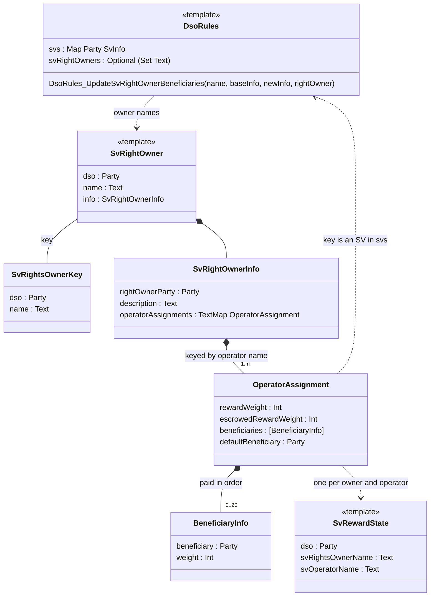

# SV rights owners PoC: types and a MainNet example



Example: a subset of the MainNet [`approved-sv-id-values.yaml`](https://github.com/canton-foundation/configs/blob/f0aa02df12e8ff2332075f796c26f89f828dcaa9/configs/MainNet/approved-sv-id-values.yaml) in the new model. Parties are shortened.

- `Digital-Asset`: one owner with two assignments at two operators.
- `Circle`: hosted by GSF, 70000 to a staking party, the rest to the default beneficiary.
- `Liberty-City-Ventures`: runs its own SV node, 70000 to one party, the rest to the owner party.
- `Franklin-Templeton`: hosted by GSF; the weight of the escrow party `FranklinTempleton-ghost-1` becomes escrowed weight, for which no coupons are created until a milestone is reached.

```jsonc
{
  "DsoRules": {
    "svs": ["Digital-Asset-1", "Digital-Asset-2", "Global-Synchronizer-Foundation", "Liberty-City-Ventures-1"],
    "svRightOwners": ["Circle", "Digital-Asset", "Franklin-Templeton", "Liberty-City-Ventures"]
  },
  "SvRightOwner": [
    {
      "name": "Digital-Asset",
      "info": {
        "rightOwnerParty": "<Digital-Asset-1 SV party>",
        "description": "",
        "operatorAssignments": {
          "Digital-Asset-1": {
            "rewardWeight": 159250,
            "escrowedRewardWeight": 0,
            "beneficiaries": [],
            "defaultBeneficiary": "<Digital-Asset-1 SV party>"
          },
          "Digital-Asset-2": {
            "rewardWeight": 159250,
            "escrowedRewardWeight": 0,
            "beneficiaries": [],
            "defaultBeneficiary": "<Digital-Asset-2 SV party>"
          }
        }
      }
    },
    {
      "name": "Circle",
      "info": {
        "rightOwnerParty": "Circle-SvRewardsActive-1::12209d45…",
        "description": "CIP-0041",
        "operatorAssignments": {
          "Global-Synchronizer-Foundation": {
            "rewardWeight": 100000,
            "escrowedRewardWeight": 0,
            "beneficiaries": [
              { "beneficiary": "Circle-SvRewardsStaking-1::12209d45…", "weight": 70000 }
            ],
            "defaultBeneficiary": "Circle-SvRewardsActive-1::12209d45…"
            // coupons: Staking 70000, Active 30000
          }
        }
      }
    },
    {
      "name": "Liberty-City-Ventures",
      "info": {
        "rightOwnerParty": "auth0_007c684b…::122078c4…",
        "description": "",
        "operatorAssignments": {
          "Liberty-City-Ventures-1": {
            "rewardWeight": 100000,
            "escrowedRewardWeight": 0,
            "beneficiaries": [
              { "beneficiary": "auth0_007c69ea…::122078c4…", "weight": 70000 }
            ],
            "defaultBeneficiary": "auth0_007c684b…::122078c4…"
            // coupons: auth0_007c69ea… 70000, auth0_007c684b… 30000
          }
        }
      }
    },
    {
      "name": "Franklin-Templeton",
      "info": {
        "rightOwnerParty": "ft::12200b55…",
        "description": "CIP-0118",
        "operatorAssignments": {
          "Global-Synchronizer-Foundation": {
            "rewardWeight": 50000,
            "escrowedRewardWeight": 40000,
            "beneficiaries": [],
            "defaultBeneficiary": "ft::12200b55…"
            // coupons: ft 10000; no coupons for the escrowed 40000
          }
        }
      }
    }
  ],
  // key: (dso, svRightsOwnerName, svOperatorName)
  "SvRewardState": [
    { "svRightsOwnerName": "Digital-Asset", "svOperatorName": "Digital-Asset-1" },
    { "svRightsOwnerName": "Digital-Asset", "svOperatorName": "Digital-Asset-2" },
    { "svRightsOwnerName": "Circle", "svOperatorName": "Global-Synchronizer-Foundation" },
    { "svRightsOwnerName": "Liberty-City-Ventures", "svOperatorName": "Liberty-City-Ventures-1" },
    { "svRightsOwnerName": "Franklin-Templeton", "svOperatorName": "Global-Synchronizer-Foundation" }
  ]
}
```

- One `SvRightOwner` per owner, with key `SvRightsOwnerKey`, a `description` and one `OperatorAssignment` per SV node operator, keyed by the operator's name.
- Each assignment has its own weight, escrowed weight, ordered beneficiaries with absolute weights, and a default beneficiary for the rest of the non-escrowed weight.
- No coupons are created for the escrowed weight. A DSO vote (`DsoRules_UpdateSvRightOwnerInfo`) lowers it once a milestone is reached.
- The owner can change only `beneficiaries` and `defaultBeneficiary`: `DsoRules_UpdateSvRightOwnerBeneficiaries` requires the operators, reward weights and escrowed weights to be unchanged.
- One `SvRewardState` per owner and operator, with key `(dso, svRightsOwnerName, svOperatorName)`.
- `DsoRules.svRightOwners` holds the owner names.
- The owner updates its beneficiaries with `baseInfo` and `newInfo`, like `DsoRules_UpdateSvRightOwnerInfo`.
- Not in this PoC: the `SvRewardState` key above (the code still has today's `svName`), dropping instructions through the key, the plural rename, the move of the instructions to `Splice.DSO.Instruction`.

## Conversion of the DevNet `approved-sv-id-values.yaml`

[`scratch/sv-rights-owners-conversion/`](scratch/sv-rights-owners-conversion/) converts the DevNet config from [canton-foundation/configs#413](https://github.com/canton-foundation/configs/pull/413), which adds `svRightsOwnerName`, into the `SvRightOwnerInfo`s above. It keeps every SV node operator and every beneficiary at its current operator. The directory is scratch and will be removed before merging.
